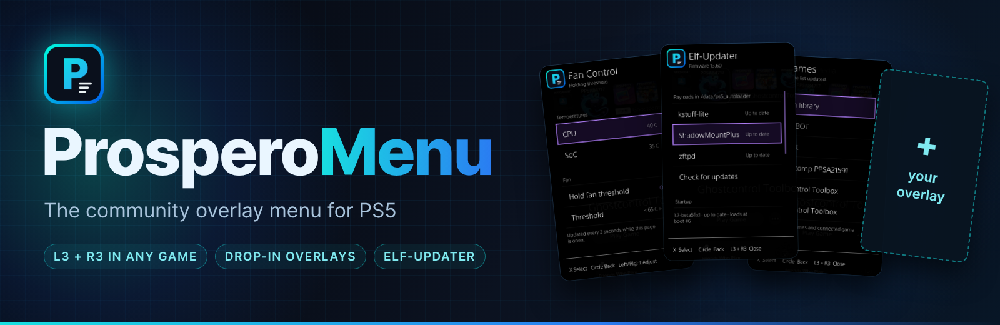
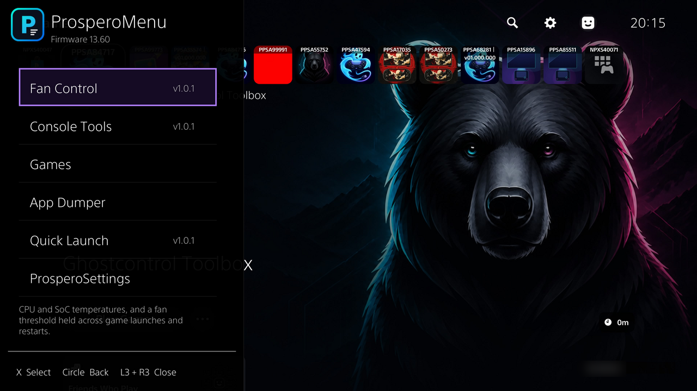
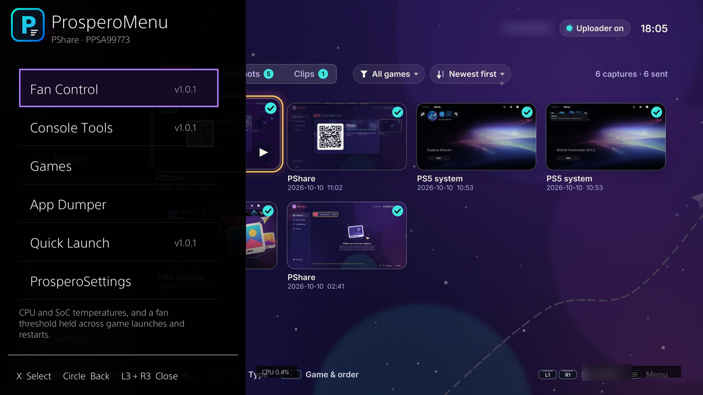
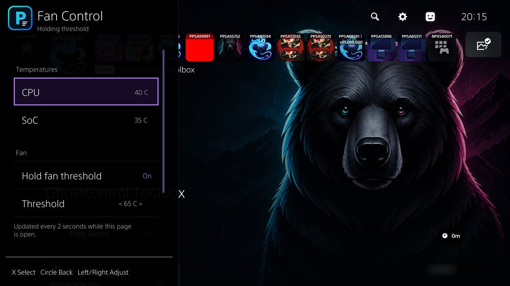
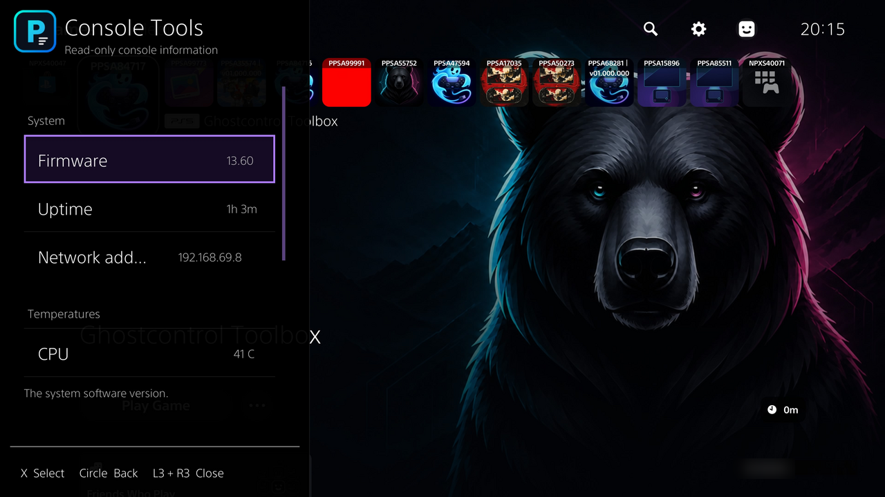
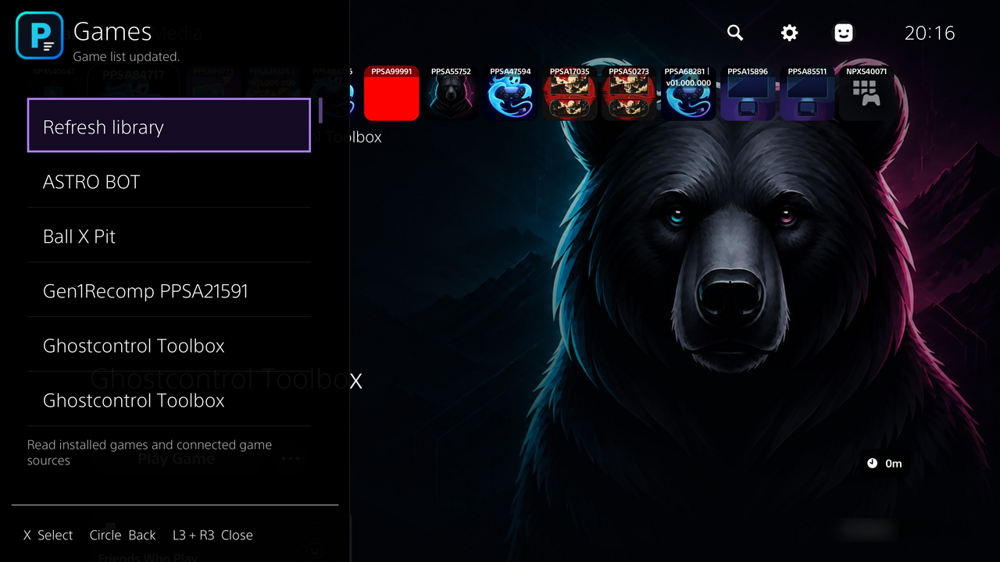
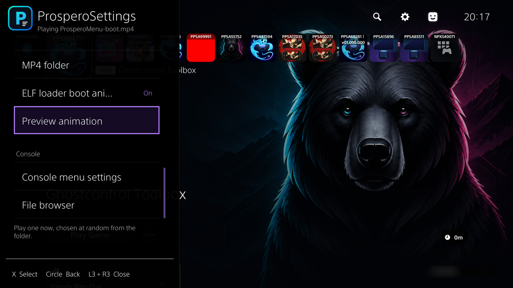
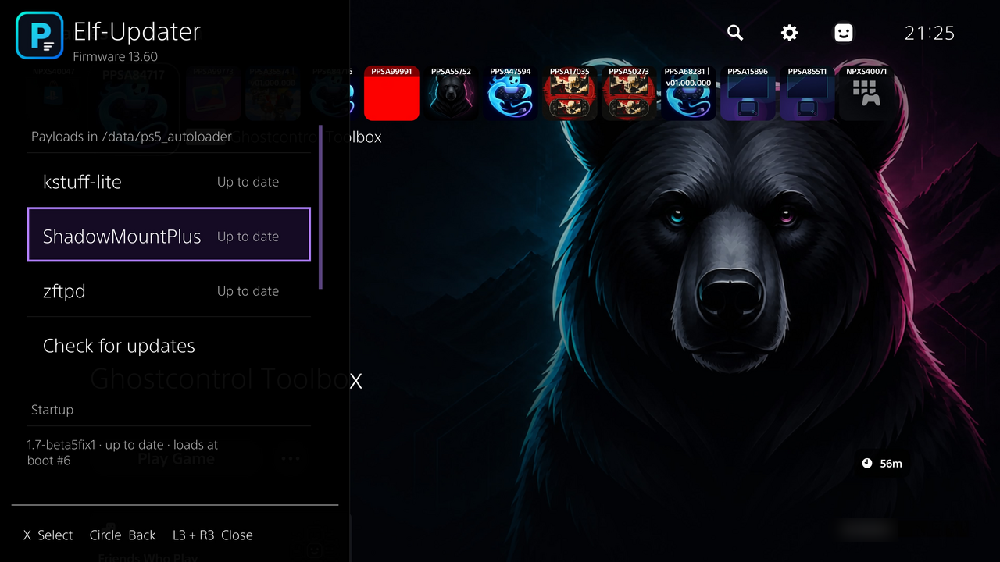
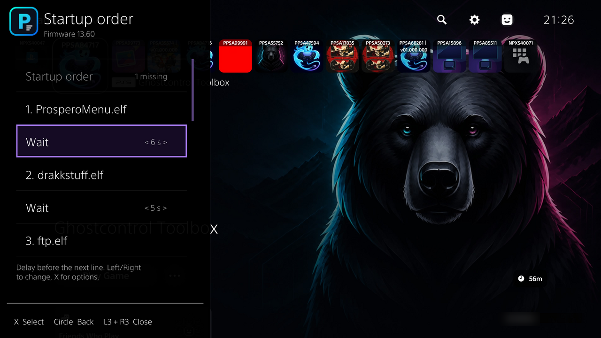

<p align="center">
  <b>The community overlay menu for jailbroken PS5 consoles, drawn natively by the system UI.</b><br>
  Open it from the home screen or in any game with <b>L3 + R3</b>.
</p>

<p align="center">
  
  
  
</p>

---

ProsperoMenu is a menu docked to the left edge of the screen. It is drawn by the
PS5's own ShellUI, so it appears over the home screen, over apps and over running
games, and it takes your controller only while it is open. Almost every entry is
an **overlay**: a folder in `/data/ProsperoMenu/overlays/` that you can add, edit or
delete without rebuilding ProsperoMenu, much like
[Tesla Menu](https://github.com/WerWolv/Tesla-Menu) overlays on the Nintendo Switch.

<p align="center">
  
  
</p>

## Features

- **Works in games.** Hold **L3 + R3** at any time. While the menu is open the game
  doesn't see your input; close it and the controller goes straight back.
- **Community overlays.** Every entry is an overlay folder. Write your own in C
  with the SDK or as a `menu.json` with no compiler, share it, and anyone can
  install it by copying the folder. See [Overlays](#overlays).
- **Boot animations.** Plays one of your MP4 clips full screen when the console
  starts, with a preview button in ProsperoSettings.
- **Works with your autoloader.** ProsperoMenu doesn't carry or start its own
  kstuff or ShadowMount. It finds the copies your autoloader started and uses
  them.
- **Elf-Updater.** Keeps kstuff-lite, ShadowMountPlus and zftpd up to date from
  GitHub, checks every file by SHA-256, and lets you rearrange `autoload.txt`
  from the controller.
- **ProsperoSettings.** Theme colours with a colour picker and presets, a
  replaceable header logo, overlay management, the boot animation, a file
  browser and console menu settings.
- **FTP share** on port 2122 for moving files to and from the console.

<p align="center">
  
  
  
</p>

## Overlays

ProsperoMenu works the way [Tesla Menu](https://github.com/WerWolv/Tesla-Menu)
does on the Switch: **the menu is the loader, and everything in it is an
overlay.** An overlay is a plain folder in `/data/ProsperoMenu/overlays/`, so
anyone can write one and share it, and anyone can install it by copying the
folder across. No rebuild of ProsperoMenu and no new ELF.

```
/data/ProsperoMenu/overlays/
  fan-control/     overlay.json  fan-control.ovl    <- program overlay (C + SDK)
  console-tools/   overlay.json  console-tools.ovl
  quick-launch/    overlay.json  menu.json          <- menu overlay (JSON only)
  your-overlay/    overlay.json  your-overlay.ovl   <- drop yours in here
```

### Installing an overlay

1. Copy the overlay's folder into `/data/ProsperoMenu/overlays/`, with an FTP
   server such as zftpd, or from a USB drive with the built-in file browser
   (ProsperoSettings → File browser).
2. Reopen the menu, or choose ProsperoSettings → Reload overlays.

The list is read every time the menu opens. An overlay whose `overlay.json` has
a mistake still shows up, greyed out, with the reason as its description. To
remove an overlay, delete its folder; to hide one, set `"hidden": true`.

### Kinds of overlay

| Kind | What it is | What you need |
|---|---|---|
| Program overlay | An ordinary PS5 payload (`<id>.ovl`) that runs as its own process and draws pages in the menu over a local socket | C and the SDK in [`sdk/`](sdk) |
| Menu overlay | Pages of shortcuts in a `menu.json`: open other overlays, run payloads from its folder, show notifications | A text editor |
| Built-in | An entry that opens one of ProsperoMenu's own pages | One `overlay.json` |

### Bundled overlays

| Overlay | Kind | What it does |
|---|---|---|
| Fan Control | Program | CPU and SoC temperatures, and a fan threshold that is held across game launches and restarts |
| Console Tools | Program | Firmware, uptime, network address, temperatures and free space on every drive |
| Elf-Updater | Built-in | Update payloads from GitHub, check them by SHA-256 and arrange the startup order |
| Games | Built-in | Installed and ShadowMount games: mount, unmount and launch |
| App Dumper | Built-in | Dump a title to USB with a live progress bar (needs the ps5-app-dumper payload) |
| Quick Launch | Menu | Example menu overlay: shortcuts to overlays and your own payloads |

### Community overlays

Made an overlay? Open a pull request that adds it to this table with a link and
one line on what it does.

| Overlay | Author | What it does |
|---|---|---|
| *Yours here* | | |

### Writing your own

- [docs/OVERLAYS.md](docs/OVERLAYS.md): every `overlay.json` field, the
  `menu.json` format and the wire protocol between an overlay and the menu.
- [`sdk/`](sdk): the C header and helpers for program overlays, with Fan Control
  and Console Tools as complete examples in [`sdk/examples/`](sdk/examples).
  The SDK is MIT licensed, so your overlay can use any licence you like.
- `npm run build:overlays` builds the examples into `build/overlays/<id>/`,
  ready to copy to the console (see [BUILDING.md](BUILDING.md)).

## Install

ProsperoMenu is a post-jailbreak payload, not an exploit. Download
`ProsperoMenu.elf` from the [releases](../../releases) page.

### With ps5_autoloader (recommended)

Copy `ProsperoMenu.elf` into `/data/ps5_autoloader/` and add it to
`autoload.txt` **after** kstuff and ShadowMount, so that ProsperoMenu can use them:

```
kstuff.elf
!1000
shadowmountplus.elf
!1000
ProsperoMenu.elf
```

Use the file names your own autoloader folder has. Lines starting with `!` are
waits, in milliseconds. Once ProsperoMenu is running, its **Elf-Updater** can
download kstuff-lite and ShadowMountPlus under exactly these names and keep them
up to date.

### By hand

1. Jailbreak the console and start an ELF loader (port 9021).
2. Start kstuff and ShadowMount if you use them.
3. Send `ProsperoMenu.elf` to the loader with your payload sender.
4. Wait for the "ProsperoMenu" notification, then hold **L3 + R3**.

**Circle** goes back and **L3 + R3** closes the menu. On first start ProsperoMenu
creates `/data/ProsperoMenu/` and installs the bundled overlays. Only one
ProsperoMenu can run per boot, so restart the console before you start a new
build.

## Boot animation

<p align="center">
  <br>
  <sub>Boot clip: <i>Womp Portal</i> by Ganja White Night x Subtronics</sub>
</p>

Put one or more `.mp4` files in `/data/ProsperoMenu/autoloadAnims/`. Each time the
console starts, ProsperoMenu picks one at random and plays it as soon as the menu
is ready. **ProsperoSettings → Preview animation** plays one immediately; close
the menu with **L3 + R3** to watch it.

<p align="center">
  
</p>

## Elf-Updater

<p align="center">
  
  
</p>

Elf-Updater keeps the payloads in `/data/ps5_autoloader/` up to date. **Check for
updates** reads the last 20 releases of each payload from GitHub and compares
the SHA-256 of your file with the digest GitHub publishes for every release
asset:

| Shown | Meaning |
|---|---|
| Up to date | Your file is the newest release |
| Update | Your file is an older release (it names which one) |
| Damaged / Unknown | Your file matches no recent release: damaged, modified or a custom build |
| Not installed | No file of that name (a renamed copy is recognised by its hash) |

Installing downloads the release, refuses it unless its SHA-256 matches GitHub's,
then replaces the file and keeps your previous copy as `<file>.prev`. It never
runs the payload and never edits `autoload.txt` by itself. **Other versions**
installs an older release or a pre-release.

**Startup order** edits `autoload.txt` from the controller:

- move a payload up, down, to the top or to the bottom; its wait moves with it
- change a wait with Left/Right
- turn a payload off without deleting it, and on again
- see which listed files are missing, and whether a USB autoloader is read first

The defaults are kstuff-lite (`kstuff.elf`), ShadowMountPlus
(`shadowmountplus.elf`) and zftpd (`zftpd-ps5.elf`). Add your own in
`/data/ProsperoMenu/elf-updater.json`:

```json
{
  "includePrereleases": false,
  "hidden": ["zftpd"],
  "sources": [
    { "id": "my-tool", "name": "My Tool", "repo": "owner/repo",
      "asset": "^my-tool-v[0-9.]+\\.elf$", "file": "my-tool.elf" }
  ]
}
```

`asset` is a regular expression for the release file name and `file` is the name
it is saved as. `hidden` removes a default.

## ProsperoSettings

ProsperoSettings is always the last entry in the menu.

- **Theme colours**: every colour of the menu, with a colour picker, swatches and
  presets.
- **Logo**: the header logo is `/data/ProsperoMenu/logo.png`. Replace the file to
  use your own (PNG, WebP or JPEG), or delete it to show the drawn mark.
- **Overlays**: reload the folder, see and stop running overlays, and restore the
  bundled examples.
- **Boot animation**: the MP4 folder, the ELF loader boot animation and Preview.
- **Console**: FPS and resource readouts, IP display, reduced motion, services
  and a file browser.

## FTP

The FTP share is on **port 2122**, rooted at `/data/ProsperoMenu/share`.

## Firmware

ProsperoMenu carries offset profiles for firmware 1.00 to 13.60
([vendor/firmware-provenance.json](vendor/firmware-provenance.json)). This release
has only been tested on 13.60 hardware. When you report a problem, include your
firmware version, what you did and what happened.

## Building

See [BUILDING.md](BUILDING.md).

## Credits

- **[Tesla Menu](https://github.com/WerWolv/Tesla-Menu)** by
  [WerWolv](https://github.com/WerWolv): the Nintendo Switch homebrew overlay menu
  and [libtesla](https://github.com/WerWolv/libtesla) framework that inspired
  ProsperoMenu's docked menu and overlay system.

## Testers

Thanks to everyone who tested the betas:

- seregonwar
- nazky
- thenextbigthing
- notsotypicalgamer

## Licence

ProsperoMenu is created by StonedModder and licensed **GPL-3.0-or-later**; see
[LICENSE](LICENSE). The overlay SDK in `sdk/` is MIT licensed. Bundled components
and adapted code keep their original copyright and licence notices with their
source.
